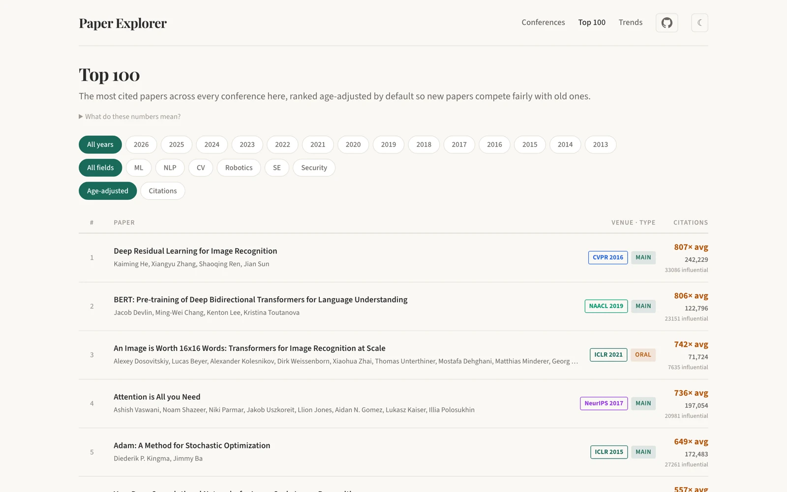
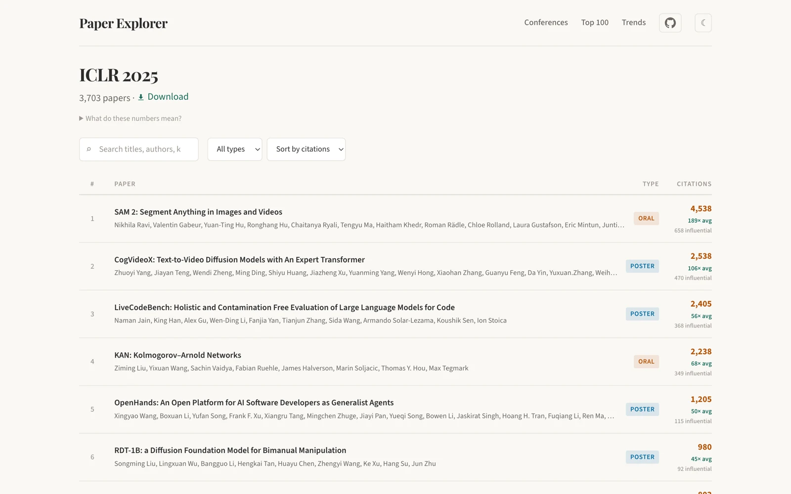

<div align="center">

# Paper Explorer

**Accepted papers from 25 top ML, NLP, CV, robotics, security and SE venues, 2013–2026,<br>with citation counts, abstracts and oral / spotlight / findings labels.**

[](https://brightjade.github.io/paper-explorer/)
[](https://github.com/brightjade/paper-explorer/releases/latest)
[](https://github.com/brightjade/paper-explorer/actions/workflows/monthly.yml)
[](LICENSE)
[](https://www.python.org/)
[](https://github.com/sponsors/brightjade)

[**Live app**](https://brightjade.github.io/paper-explorer/) · [Example usage](#example-usage) · [Quick start](#quick-start) · [Data format](#data-format) · [Conferences](#conferences) · [Commands](#commands)

| Papers | Venues | Conference-years | Years | Total citations | With abstracts |
|:-:|:-:|:-:|:-:|:-:|:-:|
| **230K+** | **25** | **280+** | **2013–2026** | **18M+** | **87%** |

<a href="https://brightjade.github.io/paper-explorer/">
  <picture>
    <source media="(prefers-color-scheme: dark)" srcset="docs/images/top100-dark.webp">
    
  </picture>
</a>

</div>

Paper Explorer collects every accepted paper from the venues below, matches each one to [Semantic Scholar](https://www.semanticscholar.org/) for citations and abstracts (95% of papers matched), and publishes the result as a monthly GitHub release and a static web app. A scheduled pipeline picks up new accepted-paper lists as venues publish them and refreshes citation counts every month.

## Example usage

### Browse in the web app

[brightjade.github.io/paper-explorer](https://brightjade.github.io/paper-explorer/) needs no install:

- **Top 100**: the most cited papers across every venue, by year and field. Ranked by raw citations or age-adjusted, which compares each paper with the papers first made public in the same quarter, so a 2025 paper can stand next to a 2016 one.
- **Conference pages**: search titles, authors and keywords, filter by track (oral, spotlight, findings, ...), sort by citations, and download the list as JSONL.
- **Author pages**: an author's papers across every venue.
- **Trends**: paper counts, topics, citation impact and venue composition by year.

<picture>
  <source media="(prefers-color-scheme: dark)" srcset="docs/images/conference-dark.webp">
  
</picture>

### Write a grounded literature survey with Claude Code

The repository ships a `/survey` skill for [Claude Code](https://claude.com/claude-code). Describe a research idea, and it searches the accepted papers in `data/` (after [Quick start](#quick-start)), ranks them by citations, and writes a survey whose related work is drawn from real accepted papers: seminal and influential work, related work grouped by theme, common datasets, benchmarks and baselines, and open gaps. Papers it adds from web search, for seminal work outside these venues, are marked as such.

```text
# Name the venues and years
/survey I'm exploring efficient inference methods for large language models,
like speculative decoding and early exit strategies. Search NLP and ML
conferences from 2023-2025.

# Or let it ask you for the scope
/survey What papers exist on 3D object detection from point clouds?
```

The report is saved to `outputs/<topic>_<timestamp>.md`.

### Query the data in Python

Each conference is one JSONL file, so the standard library is enough:

```python
import json
from pathlib import Path

# The five most cited ICLR 2025 orals
papers = [json.loads(line) for line in open("data/iclr_2025/papers_enriched.jsonl")]
orals = [p for p in papers if p["selection"] == "oral"]
for p in sorted(orals, key=lambda p: p.get("citation_count", 0), reverse=True)[:5]:
    print(p.get("citation_count", 0), p["title"])

# Every 2024-2025 paper on unlearning, across all venues
for path in Path("data").glob("*_202[45]/papers_enriched.jsonl"):
    for line in path.open():
        p = json.loads(line)
        if "unlearning" in (p["title"] + " " + p.get("abstract", "")).lower():
            print(path.parent.name, p.get("citation_count", 0), p["title"])
```

## Quick start

You need [uv](https://docs.astral.sh/uv/getting-started/installation/), which installs Python 3.13 for you.

```bash
git clone https://github.com/brightjade/paper-explorer.git
cd paper-explorer
uv sync                               # install dependencies
uv run python -m scripts.sync_data    # download the newest data release (~160 MB) into data/
```

Run `sync_data` again whenever you want the latest monthly release. It does nothing when `data/` is already current, and refuses to overwrite a `data/` it did not install or that you have changed (`--force` overrides). Without Python, `./setup.sh` downloads and unzips the same release with `gh` or `curl`; `./setup.sh data-YYYY-MM-DD` fetches a specific one.

To crawl venues yourself, set up credentials:

```bash
cp .env.example .env    # then fill it in
```

- `OPENREVIEW_USERNAME` / `OPENREVIEW_PASSWORD`: a [free OpenReview account](https://openreview.net/signup), needed only for ICLR, NeurIPS, ICML, COLM, CoRL and TMLR. Every other venue is read from public pages without auth.
- `SEMANTIC_SCHOLAR_API_KEY` (optional): an [API key](https://www.semanticscholar.org/product/api#api-key) raises the rate limits `ppr enrich` runs under.

## Data format

```text
data/<conference_id>/
├── papers.jsonl             # the crawl: title, authors, link, track
├── papers_enriched.jsonl    # + Semantic Scholar metadata, sorted by citation count
└── awards.json              # paper awards, for venues that publish them
```

A conference ID is `<venue>_<year>`, with the venue IDs listed under [Conferences](#conferences): `iclr_2025`, `emnlp_2024`, `usenix_security_2023`. Each line of `papers_enriched.jsonl` is one paper; empty fields are left out.

| Field | Meaning |
|---|---|
| `title`, `authors`, `link` | As the venue lists them; `link` is the paper page, PDF or DOI |
| `selection` | The track: `oral`, `spotlight`, `poster`, `main`, `findings`, `industry`, ... |
| `abstract`, `tldr`, `keywords` | Abstract (from the venue where it lists one, else Semantic Scholar), Semantic Scholar's one-line TL;DR, and keywords where the venue lists them |
| `citation_count`, `influential_citation_count`, `reference_count` | From Semantic Scholar, refreshed monthly |
| `publication_date`, `fields_of_study`, `open_access_pdf` | From Semantic Scholar |
| `external_ids` | `CorpusId`, `DOI`, `ArXiv`, `DBLP`, `ACL`, ... |
| `forum_id` | OpenReview forum ID, for OpenReview venues |
| `venue_date` | TMLR only: the date TMLR published the paper |
| `match_status` | How the paper was bound to its Semantic Scholar record: `matched`, `matched_fuzzy`, `not_found`, ... |

## Conferences

**ID** is the venue part of a conference ID. **Tracks** lists every label the venue's papers carry across its years.

| Field | Venue | ID | Years | Tracks |
|---|---|---|---|---|
| ML | NeurIPS | `neurips` | 2013–2025 | oral, spotlight, poster, main, datasets |
| | ICML | `icml` | 2013–2026 | oral, spotlight, poster, main |
| | ICLR | `iclr` | 2013–2026 | oral, spotlight, poster, main |
| | TMLR | `tmlr` | 2022–2026 | main |
| | AAAI | `aaai` | 2013–2026 | main |
| | IJCAI | `ijcai` | 2013, 2015–2026 | main |
| NLP | ACL | `acl` | 2013–2026 | main, findings, industry |
| | EMNLP | `emnlp` | 2013–2025 | main, findings, industry |
| | NAACL | `naacl` | 2013, 2015–2016, 2018–2019, 2021–2022, 2024–2025 | main, findings, industry |
| | COLM | `colm` | 2024–2026 | main |
| | EACL | `eacl` | 2014, 2017, 2021, 2023–2024, 2026 | main, findings, industry |
| | COLING | `coling` | 2014, 2016, 2018, 2020, 2022, 2024–2025 | main, industry |
| CV | CVPR | `cvpr` | 2013–2026 | main |
| | ICCV | `iccv` | 2013–2025 (odd years) | main |
| | ECCV | `eccv` | 2014–2024 (even years) | main |
| | WACV | `wacv` | 2013–2026 | main |
| Robotics | RSS | `rss` | 2013–2026 | main |
| | CoRL | `corl` | 2017–2026 | oral, spotlight, poster, main |
| | ICRA | `icra` | 2013–2026 | main |
| | IROS | `iros` | 2013–2025 | main |
| SE | ICSE | `icse` | 2013–2026 | main |
| | FSE | `fse` | 2013–2026 | main |
| | ASE | `ase` | 2013–2026 | main |
| | ISSTA | `issta` | 2013–2026 | main |
| Security | USENIX Security | `usenix_security` | 2013–2026 | main |

A missing year is one the venue was not held, or whose accepted-paper list is not out yet; the monthly pipeline adds it when it appears.

<details>
<summary>Notes on tracks and scope</summary>

- **Tracks.** `oral`, `spotlight` and `poster` are presentation types; `main`, `findings` and `industry` are proceedings volumes. A year whose venue does not publish presentation types labels every paper `main`, so filtering, say, ICLR 2015 or NeurIPS 2022 for orals finds none.
- **NeurIPS Datasets & Benchmarks** papers are `datasets` in 2021–2022 and `datasets_oral`, `datasets_spotlight` or `datasets_poster` from 2023.
- **TMLR** is a journal: a paper's year is the year TMLR published it, and the current year grows every month.
- **Software engineering** venues cover the research track only from 2023. For 2013–2022, FSE and ASE (and ICSE 2013) include every track, so their counts run higher than a research-track-only list would.
- **AAAI** 2013–2022 includes student abstracts and demos, which 2023 on leaves out.

</details>

## Commands

Every command runs as `uv run ppr <command>`; `--help` on any of them lists all options.

```bash
# Build the data
uv run ppr crawl iclr_2025 neurips_2025      # fetch accepted papers -> data/<id>/papers.jsonl
uv run ppr enrich iclr_2025 neurips_2025     # add Semantic Scholar metadata -> papers_enriched.jsonl
uv run ppr enrich --all --time-budget 4h     # refresh every conference in data/ within a time budget
uv run ppr awards neurips_2024               # collect paper awards -> data/<id>/awards.json
uv run ppr awards --all --all-years     # every venue-year, including the final older ones
uv run ppr validate iclr_2025                # compare paper counts with DBLP (10% tolerance)

# Keep it current (what the monthly pipeline runs)
uv run ppr discover                          # which tracked venues have a list we don't have yet
uv run ppr discover --json > discover.json
uv run ppr autoregister discover.json --report register.json   # register, crawl and check each new venue
uv run ppr rolling                           # recrawl TMLR without dropping a paper already on disk
uv run ppr release --base-tag data-YYYY-MM-DD --dry-run         # plan a data release (maintainers)

# Run the web app locally (http://localhost:5173/paper-explorer/)
./build.sh                                   # data/ -> web/public/data/
cd web && npm install && npm run dev
```

Every enrich run retries the papers no earlier run could match, since Semantic Scholar indexes a venue months after it is crawled, and re-checks each match against the record's title and authors. Conferences four or more years old are refreshed once a quarter, from IDs alone.

## How it works

1. **Crawl** each venue from where its accepted-paper list lives: the OpenReview API, conference and proceedings sites (ACL, AAAI, CVF, ECVA, USENIX, IJCAI, conf.researchr.org, roboticsproceedings.org), Crossref and DBLP.
2. **Enrich** every paper from Semantic Scholar, by ID where the crawl has one and by title otherwise, checking authors before accepting a title match.
3. **Publish** `data/` as a `data-YYYY-MM-DD` [GitHub release](https://github.com/brightjade/paper-explorer/releases) and rebuild the [web app](web/README.md) from it.

[`.github/workflows/monthly.yml`](.github/workflows/monthly.yml) runs all three on the 3rd of every month, after discovering and registering any newly published venue-years. A venue that needs a human (a new layout, a count that looks wrong) is held and reported in a GitHub issue rather than published.

## Development

```bash
uv sync
uv run pytest tests/                          # Python tests
node tests/workflow/monthly-workflow.test.js  # tests for the workflow's issue step
```

The web app (React + TypeScript + Vite) is documented in [`web/README.md`](web/README.md). Issues and pull requests are welcome, including requests for a venue.

## Citation

If Paper Explorer helps your research, please cite it:

```bibtex
@misc{choi2026paperexplorer,
  author       = {Choi, Minseok},
  title        = {Paper Explorer: Accepted Papers and Citations from Top {AI} Venues},
  year         = {2026},
  howpublished = {\url{https://github.com/brightjade/paper-explorer}}
}
```

## Acknowledgments and license

Paper metadata comes from [OpenReview](https://openreview.net/), [Semantic Scholar](https://www.semanticscholar.org/), [DBLP](https://dblp.org/), [ACL Anthology](https://aclanthology.org/), [CVF Open Access](https://openaccess.thecvf.com/), [ECVA](https://www.ecva.net/), [Crossref](https://www.crossref.org/) and the venues' own websites, and remains subject to their terms. The code is released under the [MIT License](LICENSE).
